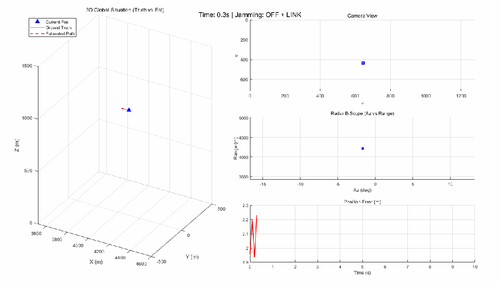

# Theoretical Framework for Multi-Source Information Fusion of Air-to-Air Missiles in Strongly Combat Environments [with MATLAB Code]

The theoretical framework of multi-source information fusion for air-to-air missiles in strong adversarial environments
This paper addresses the precise tracking requirements for high-maneuverability targets in electronic countermeasure (ECM) environments, systematically elucidating a set of multi-source information fusion guidance theory and model frameworks. This framework encompasses key theoretical components such as target maneuver models, heterogeneous sensor observation models, interference mechanism modeling, federated extended Kalman filtering, and guidance parameter reconstruction. By introducing Singer's maneuver model, Van Loan's precise discrete method, and a federated filter structure based on information allocation, the system's robustness in state estimation under complex interference conditions such as infrared decoys, radar foils, and data link degradation has been significantly enhanced. The paper focuses on deriving the mathematical models of each module and illustrates their physical meanings and working mechanisms through typical examples.
1 Introduction In the modern air combat environment, target aircraft are generally equipped with advanced self-defense electronic countermeasure systems capable of launching infrared decoys and radar decoys, and may also interfere with data links. The final guidance phase of air-to-air missiles requires a rapid integration of heterogeneous information from radar, infrared, cameras, and data links to precisely estimate the motion state of the target and generate guidance commands such as line-of-sight angular rate, approach speed, and target acceleration required for proportional guidance and its improved forms. To achieve this, it is necessary to establish a complete theoretical framework that can describe the complex maneuvers of targets, simulate the physical characteristics of sensors and interference effects, and implement robust information fusion. This paper will explain the mathematical models and physical principles behind these functions layer by layer.
2 Target Motion and Dynamics Modeling 2.1 Generation of Target Maneuver Commands The tactical maneuver of the target is described by a maneuver dispatcher, which outputs three independent control commands based on typical mission profiles (such as interception-evasion for fighter aircraft, "runway" for early warning aircraft). The tangential acceleration changes the rate of change along the velocity direction; The horizontal turning angular rate is achieved by generating a normal (centripetal) acceleration to achieve the change in heading; The climb rate command drives the height change.
2.2 The flight mechanics integral model converts control commands into three-dimensional motion in the inertial coordinate system, using a constant acceleration integral model. The state at a given moment is defined as position, velocity, and acceleration. The time step is denoted by dt. The discrete iterative formula is:
The acceleration vector is generated by the command synthesis:
Among them, is the instantaneous yaw angle and vertical channel gain. The attitude angle is calculated by inverse kinematics from the velocity vector and the turn rate. This model provides "true" data for simulation, not included within the filter itself.
2.3 Internal Predictive Models for Filters (CV/CA/Singer) in Object State Estimators, often employ different motion models to predict target behavior. To unify description, consider a single-axis state vector, namely position, velocity, and acceleration. The continuous-time state space model is:
The continuous white noise with power spectral density is the one. The three common models are as follows:
Constant Velocity Model (CV): The velocity is modeled as a random walk process, with acceleration being directly driven by white noise to change the velocity. In engineering implementations, it is often added an accelerated decaying acceleration state to maintain the same dimensionality of states.
Constant Acceleration Model (CA): The acceleration (jerk) is white noise, and the state matrix is .
Noise intensity.
Singer model: An exponentially auto-correlated first order Markov process with a mobility time constant representing the expected duration of target maneuver, and a mobility intensity characterized by the variance of steady-state acceleration. The state equation:
The corresponding matrix is  .
2.4 Van Loan Precise Discrete Filtering Method: The discrete prediction step of the filter requires a precise discrete state transition matrix and process noise covariance. For linear time-invariant systems, matrix exponentiation can be used for a one-time solution. Constructing the augmented matrix:
Compute its matrix exponential, where denotes the block submatrix. Compared with direct Taylor expansion approximation, the Van Loan method can ensure numerical precision, especially suitable for large time steps or fast-varying dynamics.
Numerical example: Take s, s, and Singer's model single-axis discrete transition matrix:
The visible acceleration state only decays by about 0.5% within 0.1 seconds, reflecting the Singer model's "memory" characteristic for sustained maneuverability, which outperforms the CA model's approach of treating acceleration as a constant and the CV model's complete neglect of acceleration.
After obtaining the single-axis matrix, using the assumption of decoupling motion along each axis, an expanded 9x9 matrix in three dimensions is obtained through the Kronecker product form and arranged in order.
3 Multi-sensor Observation Model 3.1 Radar Observation Equation The radar provides four measurement quantities: range, azimuth angle, elevation angle, and Doppler velocity. In spherical coordinates, the nonlinear observation equation is:
Measurement noise is assumed to be zero mean Gaussian white noise with power spectral density matrix, typical parameters: m, m/s.
3.2 Infrared Sensor The IR sensor provides high-precision angle measurements, with its azimuth and elevation being identical to the true values of the radar angle, but its noise is much less than that of the radar. The observation vector is simplified to.
3.3 Optical Camera The camera uses a pinhole perspective projection model. Given the camera focal length (in pixels) and principal point coordinates, the target's coordinate in the camera coordinate system is given by. The projection equation is:
Only valid measurements are output when the target is located in front of the camera and the pixel coordinates are within the effective field of view. The standard deviation of measurement noise is usually 1 to 2 pixels.
3.4 Data Link The Data Link provides over-the-horizon target indications from platforms such as warning aircraft, outputting the target's three-dimensional position and velocity in the inertial frame. Due to signal propagation and network latency, this measurement has uncertain delays (s, s) and an independent Bernoulli packet loss process, with a packet loss rate of up to 10%. The receiving end compensates for time delay based on the message sending timestamp, linearly extrapolating to approximate current position:
The measurement noise is Gaussian noise with standard deviation m and m/s, significantly inferior to the own radar and photoelectric devices.
4 Electronic Warfare Environment Modeling 4.1 Infrared Flare The flare is launched from the tail of the carrier aircraft, initially adding a downward component of velocity, followed by motion under gravity and air resistance. Its dynamic equation:
In the formula, the drag coefficient (typical value 0.5) is used. By employing linear integration, the position of the decoy can be determined. Due to its high radiation intensity, the decoy forms a very bright interference source in the IR/camera field of view, which may cause the tracking gate to deviate.
4.2 After the chaff is released, its initial velocity is the same as that of the carrier aircraft, and it then rapidly decelerates and disperses under atmospheric obstruction. The speed change is described by an exponential decay model:
The time constant is usually several seconds. The chaff cloud forms a large-scale radar scattering body, whose backscatter power and Doppler spectrum spread far exceed typical targets, easily causing radar automatic detection and tracking algorithms to mislock.
4.3 Under interference conditions, sensors may output false measurement values to replace real target information. For example, the IR/camera system may lock on the brightest decoy, using the decoy's angular position as the target measurement; the radar range - speed gate may be captured by the chaff cloud, outputting the average distance and Doppler spread of the chaff cloud. Therefore, the actual measured values received by the filter may be contaminated, requiring a fused algorithm capable of distinguishing or suppressing false information.
5.1 The overall architecture of the federated Kalman filter for handling multi-source asynchronous and different precision sensor information and enhancing robustness against local sensor failures or deceptions adopts the structure proposed by Carlson. The system includes four parallel sub-filters: a radar sub-filter, an IR sub-filter, a camera sub-filter, and a data link sub-filter. Each sub-filter is an extended Kalman filter (EKF), independently maintaining the full state (9-dimensional) and covariance matrix of the target.
At the beginning of each filtering cycle, the fusion center assigns global estimation information to each sub-filter according to the information allocation factor:
Representing the confidence level for each sub-filter, which is typically preset based on the sensor accuracy and anti-interference capability. For example, close-range high-precision radar and cameras may be given higher weights (), while IR is second (), and data links are assigned the least weight due to their noise and uncertainties in delay ().
5.2 Sub-filter Temporal Update (Prediction) - Each sub-filter uses the same target motion model (such as the Singer model) and corresponding discrete state matrix for a one-step prediction:
The update is generated by the Van Loan method from the continuous model.
5.3 Sub-filter Observation Update - For each sub-filter, EKF updates are performed based on its corresponding sensor model.
Radar update: Nonlinear functions and analytical Jacobian matrices are used to calculate new measurements. Angle new measurements are constrained within. The new measurement covariance is then calculated, Kalman gain is applied, and finally, the state and covariance are corrected.
Infrared and camera update: Infrared only utilizes subsets, while cameras use corresponding Jacobians, with similar procedures.
Data link update: Data links provide linear observations, with an observation matrix of . To suppress large noise and potential pollution in data links, a very large measurement noise covariance is artificially set, where m, m/s. This essentially reduces the statistical weight of data links during fusion, making them only a backup reference when other sensors are unavailable.
5.4 Global Fusion - After independent updates by each sub-filter, the fusion center achieves global optimal estimation through inverse covariance weighting:
This fusion criterion is the optimal combination under maximum likelihood, and it can accommodate any sub-filter failure (just setting its information matrix to zero). For numerical robustness, a small regularization term is added to the covariance inversion (e.g., ). The global state and covariance after fusion will serve as the starting point for the next cycle, forming a closed-loop reset.
Anti-interference Mechanism: When radar suffers foil-induced decoys leading to increased measurement errors, its new measurements increase, and the estimated error covariance also increases; conversely, if the camera still captures real targets, its value remains smaller. During inverse covariance fusion, the contribution of the radar automatically diminishes, and the global estimate will mainly follow the camera and infrared, thus suppressing the impact of decoy interference and achieving "soft switching" rather than hard decision.
6. The output of the guidance parameter reconstruction filter contains the global state of the target position, velocity, and acceleration. In conjunction with the missile's own state (provided by the navigation system), all parameters required for proportional guidance and its enhanced forms can be directly derived.  
Calculation of the line-of-sight vector and relative motion:  
å  
¾  
„  
å  
  
‘  
æ  
Ž  
è  
¿  
‘  
é  
€  
Ÿ  
ç  
Ž  
‡  
The line-of-sight angular rate vector is a core quantity:  
Its modulus is used in classical proportional guidance commands, where , and is the navigation ratio.  
The estimate of the target's acceleration is directly taken from it, and in enhanced proportional guidance (APN), the vertical component of acceleration perpendicular to the line of sight is used to compensate for target maneuvers:  
The remaining flight time is estimated approximately (requires m/s).  
7. Conclusion This paper discusses the final guidance tracking of air-to-air missiles under strong adversarial scenarios, comprehensively discussing the theoretical framework from target motion modeling, heterogeneous sensor measurement equations, interference mechanisms against adversaries, to federated Kalman filter integration and guidance parameter reconstruction. Through Van Loan's precise discrete multimodel prediction, distributed fusion based on information allocation, and statistical weighting strategies for data links, the system improves estimation accuracy and robustness at multiple levels. The mathematical models and parameter configurations established can provide a theoretical foundation for related simulation experiments and algorithm design.  
This framework can be further expanded to Interactive Multimodel (IMM) to adaptively switch movement modes, introduce Probabilistic Data Association (PDAF) to handle multiple false targets, and integrate Passive Angle Estimation (ESM) as an auxiliary information to adapt to more complex battlefield environments.

## Images

<!-- PAYMENT_BLOCK -->

## Get this dataset

- Payment link (Stripe): [Buy now](https://buy.stripe.com/3cs8yP7sY87d0vu9AB)
- Payment QR code: 

<!-- /PAYMENT_BLOCK -->
